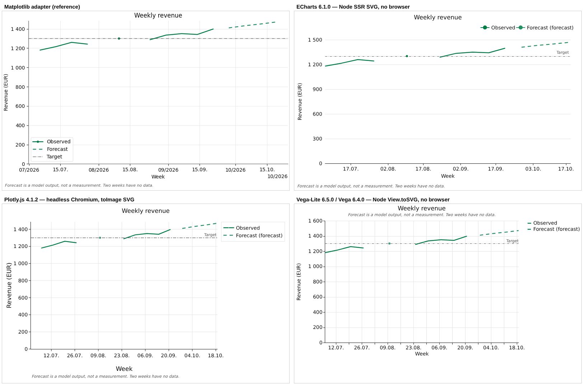
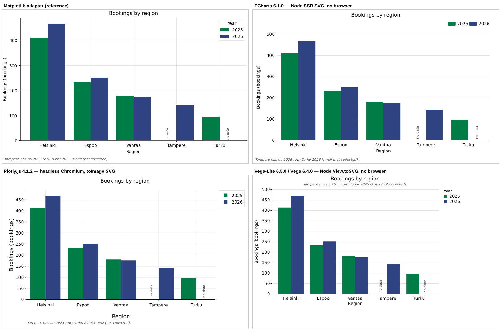
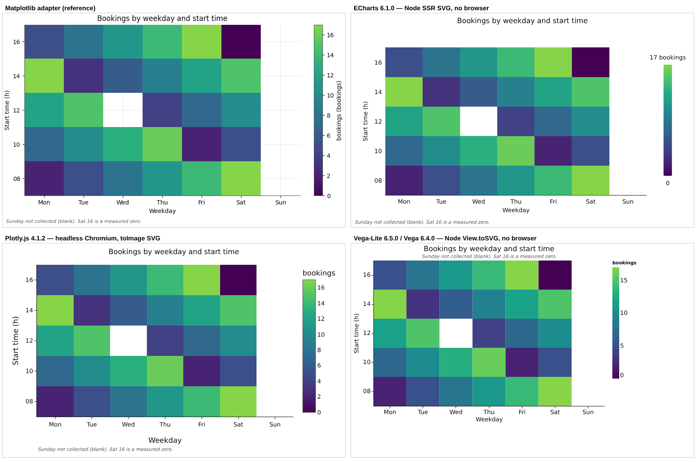
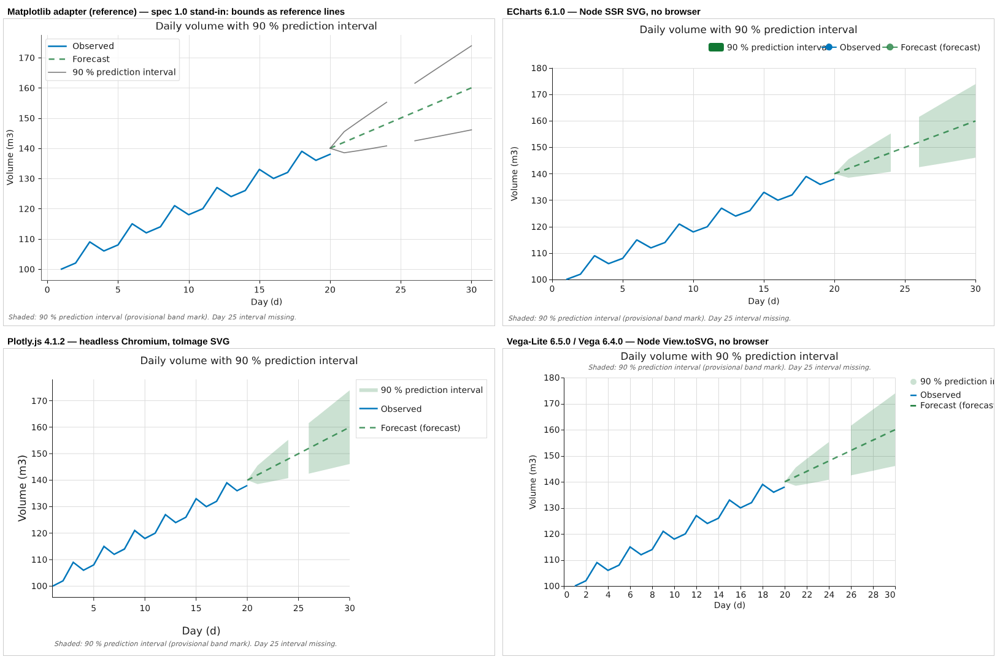

# Browser renderer evaluation

Decision record for the Phase 2 item "Browser renderer evaluation (Plotly vs
ECharts vs Vega-Lite) ... Written decision first" (ROADMAP, *Phase 2 onward*),
and the plan for the Vue 3 package that follows it. Written 2026-10-15.

**Decision: Apache ECharts 6 is the primary browser engine.** Vega-Lite is the
runner-up. Plotly.js is not chosen as the primary engine; it stays a
candidate for a specialist 3D/scientific adapter. Matplotlib stays the
publication path for PNG/SVG/PDF. Reasons, risks and the conditions that would
reopen the decision are in [Recommendation](#recommendation).

Every number below says how it was obtained:

- **measured**: produced by the spikes in [`spikes/browser/`](../spikes/browser/README.md)
  (Node 22.22.0, Playwright 1.56.1 with Chromium 1194 headless, software
  rendering, no GPU; package versions pinned in its `package.json`);
- **registry**: read from the npm registry on 2026-10-15 (`npm view`);
- **cited**: from the linked documentation or changelog, not exercised here;
- **unverified**: my expectation, not checked. Treat as a question.

## What the browser renderer has to do

From VISION_AND_ARCHITECTURE §3, §6, §10, CONVERSATIONAL_UI_AND_REPORTING §2-4,
SPEC.md, RENDERING.md and THEMES.md (on `main` since the corporate-themes merge):

- render the **same FigureSpec JSON** (later ViewSpec) that the Matplotlib
  adapter renders, with **no misleading difference** between static and
  interactive output (CONVERSATIONAL_UI §4);
- keep the claim rules: a null is a gap, never 0; a labelled bar slot with no
  value says "no data"; units on axes; forecasts distinguishable whatever
  style they ask for; uncertainty intervals expressible, with level and kind
  stated (ROADMAP: band / errorbar / interval encodings);
- use the **same themes** (`Theme.to_json()` tokens, fi-FI number and date
  locale) and show dates in the spec's timezone, not the viewer's;
- persistent **interaction state** and agent-driven focus/highlight;
- **static capture** of a browser view into the artifact manifest;
- stay host-neutral: Vue 3 is the first host, the schema is not Vue-specific.

## Candidates and versions

| Engine | Version | Licence | Stable releases 2025-01..2026-10 (registry) | Vue 3 integration (registry) |
|---|---|---|---|---|
| Apache ECharts | 6.1.0 (2026-05-19) | Apache-2.0 | 2: 6.0.0 (2025-07-30), 6.1.0 | `vue-echarts` 8.3.2 (2026-10-09; peer `vue ^3.3`, `echarts ^6`), 7 releases in the period |
| Plotly.js | 4.1.2 (2026-10-05) | MIT | 19 (3.x and 4.0.0 on 2026-08-24) | none maintained: `vue-plotly` 1.1.0 last published 2020-01-22, `vue3-plotly` 0.0.7 on 2023-06-21 |
| Vega-Lite / Vega / vega-embed | 6.5.0 / 6.4.0 / 7.3.0 | BSD-3-Clause | 12 / 12 / 6 | none official (`vue-vega` 1.0.0-alpha.13, last published 2017-12-12); vega-embed is a single call to wrap |
| Observable Plot (comparator) | 0.6.17 (2025-02-14) | ISC | 1 | none |
| uPlot (comparator) | 1.6.32 (2025-03-14) | MIT | 1 | none |

Transitive licences of what each bundle actually contains (measured,
`licences.mjs`, esbuild metafile): ECharts 3 packages (Apache-2.0 echarts,
BSD-3-Clause zrender, 0BSD tslib); Plotly partial bundle 18 packages (15 MIT,
2 BSD-3-Clause, 1 Zlib); vega-embed 59 packages (36 BSD-3-Clause, 21 ISC, 1
MIT, 1 Unlicense). All permissive. Redistributing an ECharts bundle means
shipping, next to it: ECharts' `LICENSE` (Apache-2.0) and `NOTICE`; the d3
BSD-3-Clause text in `echarts/licenses/LICENSE-d3`, because ECharts' `LICENSE`
lists d3-derived code in `src/util/number.ts` (in every bundle, including the
FigureSpec set) and in the treemap, tree and graph (force) layouts (in a
bundle once those series are registered); and zrender's BSD-3-Clause
`LICENSE` (read from the installed `echarts` 6.1.0 and `zrender` packages).
The package's bundle build should collect these files rather than rely on
someone remembering them.

## Bundle size (measured)

esbuild 0.28.2, ESM, minified, tree-shaken, `NODE_ENV=production`, gzip -9 and
brotli -11 (`measure-sizes.mjs`; entries in `spikes/browser/size-entries/`).
Plotly's ESM-from-CommonJS bundle is not tree-shaken by esbuild; its own
prebuilt partial bundles are listed for comparison.

| Bundle | min KiB | gzip KiB | brotli KiB |
|---|---:|---:|---:|
| **ECharts, FigureSpec set** (line, bar, scatter, heatmap, custom; grid, polar, tooltip, legend, title, dataZoom, markLine/Area/Point, visualMap, dataset, aria, brush, toolbox; SVG + canvas renderers) | 780.0 | **264.8** | 220.6 |
| ECharts, lower bound (line, grid, tooltip, SVG renderer) | 510.5 | 175.7 | 149.4 |
| ECharts, everything (`echarts.min.js` as shipped) | 1095.6 | 360.4 | 291.8 |
| echarts-gl 2.1.0 add-on (prebuilt UMD; its ESM build does not bundle, see 3D) | 624.8 | 170.6 | n/m |
| **Plotly, FigureSpec set** (core + scatter, bar, heatmap, histogram, scatterpolar, barpolar, quiver) | 1229.3 | **428.1** | 347.4 |
| Plotly, same + scatter3d, surface, cone | 1807.3 | 599.9 | 479.8 |
| Plotly core only (includes scatter) | 1090.5 | 377.5 | 309.3 |
| Plotly `plotly-basic.min.js` / `plotly-cartesian.min.js` as shipped | 1170.4 / 1472.6 | 391.6 / 491.7 | 324.1 / 403.1 |
| Plotly full (`plotly.min.js`) | 4721.1 | 1453.4 | 1089.3 |
| **Vega-Lite + Vega + vega-embed** | 822.4 | **285.1** | 241.9 |
| Vega-Lite + Vega, no vega-embed | 763.7 | 264.2 | 224.8 |
| Vega runtime only (specs compiled to Vega ahead of time) | 506.5 | 180.6 | 153.8 |
| Observable Plot (with its d3 modules) | 384.6 | 131.0 | 111.0 |
| uPlot | 50.8 | 22.6 | 20.4 |

## The spikes

Four specs exercise the claim rules (`spikes/browser/reference/make_specs.py`;
the first three are validated by `ieeVisualizer.spec.validate`, the fourth uses
a provisional `band` mark that spec 1.0 cannot parse):

1. **line**: weekly revenue in EUR, datetime x with `+03:00` offsets and
   `provenance.timezone = Europe/Helsinki`, two null weeks around a lone
   value, a forecast layer (`role: forecast`), y limits `[0, null]`, a
   reference line;
2. **grouped_bar**: regions x years; one null value and one absent row, both
   must read "no data";
3. **heatmap**: weekday x start time; Sunday all null, one null cell, one
   measured zero (must be coloured, not blank);
4. **band**: observed line, forecast median, 90 % prediction interval as
   `{"type": "band", "encoding": {"x", "y_lower", "y_upper"}, "interval_level": 0.9,
   "interval_kind": "prediction"}` with one missing interval (the band must
   break).

All three top candidates got an adapter `figureSpecTo<Engine>(spec, theme)`
(`spikes/browser/adapters/`); the top two were not separable on paper, so the
third was cheaper to build than to argue about. Theme: `report-light`
1.0.0 consumed directly as `Theme.to_json()`. ECharts and Vega render to SVG in
Node; Plotly renders in Chromium. All four PNGs are 800x500 px. Node ran with
`TZ=America/New_York` and the browser with `timezoneId: America/New_York` on
purpose.

### Side by side (Matplotlib | ECharts / Plotly | Vega-Lite)






What the images show (measured, after the adapter fixes listed below):

- **Nulls.** All three break lines at nulls by default (ECharts `'-'` value
  with `connectNulls: false` default; Plotly `connectgaps: false` default;
  Vega-Lite 6 `invalid: "break-paths-show-path-domains"` default for paths,
  [source of 6.5.0, the version spiked](https://cdn.jsdelivr.net/npm/vega-lite@6.5.0/src/invalid.ts),
  also in the installed package's `src/invalid.ts`). No
  engine marks a **lone value between two nulls** by itself: with lines only it
  is invisible in all three; each adapter adds a marker for it, as the
  Matplotlib adapter does. Null heatmap cells are blank and the measured zero
  is coloured in all three. "no data" bar labels had to be drawn by every
  adapter; none of the engines has the notion.
- **Timezone.** Every point sits on its Helsinki date in all engines although
  the process and browser were in New York, because the adapters convert each
  instant to its wall-clock reading in `provenance.timezone` and run the engine
  in UTC mode. None of the three can format in an arbitrary IANA zone: ECharts
  has only `useUTC: boolean`, Plotly's schema has no timezone attribute and
  treats dates as naive strings, Vega-Lite has `utc` and local scales (measured
  from the shipped `echarts.d.ts`, `plot-schema.json` and Vega-Lite types).
  The naive alternative, `new Date("2026-07-06T00:00:00+03:00")` in New York,
  is `Sun Jul 05 17:00` (measured): every weekly point would move a day.
- **Forecast.** Dashed with doubled gaps, the theme's `roles.forecast_line_alpha`
  as opacity (0.85 in `report-light`; 0.75, the Matplotlib default,
  when a theme leaves it out), legend says
  "(forecast)", same colour as the observed series it continues (the
  Matplotlib rule). Equivalent in all three.
- **Locale.** fi-FI grouping (`1 400`) works in all three: ECharts via a
  formatter, Plotly via `separators`, Vega via `config.locale`. Date tick
  labels follow the theme's strftime patterns in ECharts (patterns translated
  to `{dd}.{MM}.` templates) and Plotly (`tickformatstops`, d3 directives); in
  Vega-Lite a per-level format object was silently dropped (warning
  `customFormatTypes`), so a `labelExpr` picks the pattern.
- **Differences from Matplotlib** that remain are layout, not data: tick
  positions (each engine's own nice-number choice), legend placement (none
  implements Matplotlib's "best inside unless it covers data" rule), heatmap
  colour bars with fewer ticks in ECharts.
- **ECharts Node SSR text measurement.** In the band figure the Node-rendered
  ECharts legend entries overlap ("90 % prediction interva" runs into
  "Observed"); the same option rendered by ECharts in Chromium is laid out
  correctly
  ([browser render](../spikes/browser/out/probe/echarts-browser-band.png)).
  Without a canvas, SSR estimates text widths. Vega's Node SVG estimates too
  (an early version truncated a legend label) but showed no overlap here.

### Defects the spikes hit (each now handled in the adapter)

| Engine | Default behaviour that would have made a false claim | Evidence |
|---|---|---|
| Plotly | `fill: "tonexty"` fills straight across a null bound: the band looked continuous over the missing day 25 | [image](../spikes/browser/out/findings/plotly-band-tonexty-bridges-null.png) |
| Plotly | category strings `"08"`, `"10"` were auto-typed as numbers (axis showed `8`) | [image](../spikes/browser/out/findings/plotly-heatmap-numeric-like-categories-cast.png) |
| Plotly | `range: [0, null]` + `autorange: "max"` did not keep 0; the first observed point was cut off. `autorangeoptions.minallowed` works | first compare render |
| Vega-Lite | `invalid: "filter"` on the heatmap removed the all-null Sunday column from the axis entirely | [image](../spikes/browser/out/findings/vegalite-heatmap-null-column-dropped.png) |
| Vega-Lite | one layer with `legend: null` on the shared colour scale removed the whole line legend | first compare render |
| ECharts | a custom series without `encode` is ignored by axis extents: the band ran above the plot | [image](../spikes/browser/out/findings/echarts-custom-series-outside-axis-extent.png) |
| ECharts | automatic ARIA description reads epoch milliseconds and `NaN` for the nulls (below) | `out/probe-results.json` |
| all | forecast colour: without porting the Matplotlib pairing rule the forecast got the next palette colour | first compare render |

The last row matters most for the plan: the Matplotlib adapter holds
presentation rules (forecast pairing, dash doubling, isolated-point markers,
"no data" slots, legend wording, colour-cycle wrap) that every browser engine
needs too. See [render plan](#a-shared-render-plan).

### The interactive path: tooltips and spec text

The static renders above say nothing about what a person reads on hover, and
that is where the first version of the ECharts adapter broke the claim rules.
`escape-check.mjs` checks it, on a fixture derived from the line spec with
hostile text in the series name, the reference-line label and the title
(`Target {b} {c} {a|x} <script>...</script>`, `Observed {b} `).
Measured against the adapter before and after the fix (the "before" run uses
the adapter files of commit `e6e76f6`, copied out with `git show` and passed as
`ADAPTER=<dir>`):

| Check | Before | After |
|---|---|---|
| reference label drawn literally (Node SSR SVG and Chromium SVG) | no: a string `formatter` is a template, rendered as `Target Target {b} {c} ... 1300 ...` | yes: the label is returned by a function |
| tooltip number | `1,180`: engine default, en-US grouping, no unit | `1 180 EUR`: theme number format and the column's unit, as on the axis |
| tooltip date | `2026-07-06 00:00:00` | `06.07.2026`, the theme's date pattern in the spec's timezone |
| tooltip for a null week | `-` | `no data` |
| injected element / script ran | no / no (the default tooltip encodes series names) | no / no |

13 of 13 checks pass after the fix (`out/escape-results.json`), 8 of 13 before
(`out/escape/control-results.json`). The fixture itself is written to
`out/escape/line-hostile-labels.json`.
Rules that follow, for the package and not only the spike:

- **Tooltips are generated from the shared render plan**, never from engine
  defaults: formatted numbers with units, dates in the spec's timezone,
  "no data" for nulls, the same legend wording as the static render.
  The spike's `tooltipFormatter` (in `adapters/echarts.js`) builds them from
  the spec through the same helpers the static path uses; in the package it
  reads the RenderPlan.
- **Spec and agent text is data, never markup or template.** ECharts sets
  tooltip content with `innerHTML`, so every spec-supplied string in an HTML
  tooltip is escaped (an unescaped series name in a custom formatter ran its
  `onerror` handler, measured), or tooltips use `renderMode: 'richText'`
  (canvas text, no HTML; not exercised here). Labels are passed as functions,
  not as string `formatter`s, so `{b}`/`{c}` are not substituted. Colours from
  a spec go into a `style` attribute only after validation (`safeColor`).
- **Interaction and tooltip parity need fixtures**, like the static claims:
  null weeks, no-data bar slots, forecast wording, band bounds, units, a
  foreign viewer timezone, and the hostile-label fixture above, each asserted
  on what the tooltip and the accessible description actually contain.

**Content Security Policy.** The ECharts and Plotly 2D bundles contain no
`Function` constructor and no `eval` (grep of the built bundles, see the
comparison table), so they run under a CSP without `'unsafe-eval'`. Vega
compiles expressions with `Function(...)`; under a strict CSP it needs the
`vega-interpreter` path or does not run. This matters for the hosts the
package is meant for: a sandboxed iframe or an embedding product with its own
CSP rules out Vega's default path, and an HTML email cannot run any of the
engines (no script), which is why email gets the Matplotlib PNG of record. A
host that cannot allow `'unsafe-eval'` is one more reason against Vega-Lite as
primary; the HTML tooltip is a reason to treat every spec string as untrusted
in whichever engine is chosen.

## Comparison

Legend: **M** measured here, **C** cited, **U** unverified.

| Criterion | ECharts 6.1 | Plotly.js 4.1 | Vega-Lite 6.5 |
|---|---|---|---|
| Licence | Apache-2.0, plus d3-derived BSD-3-Clause code and zrender BSD-3-Clause: ship `LICENSE`, `NOTICE`, `LICENSE-d3`, zrender's `LICENSE` (M, read from the packages) | MIT (M) | BSD-3-Clause (M) |
| Strict CSP (no `'unsafe-eval'`) | FigureSpec bundle: no `Function` constructor, no `eval` (M). The full `echarts.min.js` has one `new Function`, a JSON fallback in `registerMap` reached only without `JSON.parse` (M) | FigureSpec 2D bundle: neither (M). 3D/full bundles: one `new Function("return this")` in a `try`, webpack's global-object fallback (M) | runtime **needs `'unsafe-eval'`**: expressions, field accessors and comparators are built with `Function(...)` (M, every Vega bundle); the CSP route is `vega-interpreter` (2.3.2, AST interpreter, ~10 % slower per its README) with `parse(spec, null, {ast: true})` (C, not exercised) |
| HTML injection (XSS) from spec text | tooltip content is set with `innerHTML` (15 `innerHTML` uses in the FigureSpec bundle: tooltip, toolbox data view, painters) (M); the default tooltip encodes series names (M), a custom formatter's return value is not encoded: an unescaped series name ran its `onerror` handler (M). String formatters are `{a}`/`{b}`/`{c}` templates (M) | not examined (5 `innerHTML` uses in the FigureSpec bundle) (U) | not examined (tooltip handler in vega-embed) (U) |
| Bundle, FigureSpec set, gzip | **265 KiB** (M) | 428 KiB (M) | 285 KiB; 181 KiB precompiled (M) |
| line, scatter, area | native (M: line) | native (M: line) | native (M: line, area) |
| bar incl. grouped / horizontal | native; grouped M, horizontal C | native; grouped M, horizontal C | native; grouped via `xOffset` M, horizontal C |
| histogram | bar of pre-binned data (U: adapter bins) | native `histogram` trace (C) | native `bin` transform (C) |
| heatmap with null cells | native; null cell blank (M) | native; null cell blank (M) | `rect`; needs explicit domain (M) |
| quiver | custom series (U) | native `quiver` trace since 4.0.0 ([changelog](https://unpkg.com/plotly.js@4.0.0/CHANGELOG.md), C) | `point` with `shape: "arrow"` + `angle` (U) |
| function, sampled | as line (M) | as line (M) | as line (M) |
| uncertainty band | custom series polygon (M) | `fill: "tonexty"` pairs, split at nulls (M) | `area` with `y`/`y2` (M); `errorband` (C) |
| error bars | custom series ([example](https://echarts.apache.org/examples/en/editor.html?c=custom-error-bar), C) | native `error_y` (C) | `errorbar` mark (C) |
| null handling default | breaks lines (M) | breaks lines (M); **bridges fills** (M) | breaks paths (M); filter removes empty categories (M) |
| log / time / category axes | yes / local or UTC only / yes (M: time, category) | yes / naive only / yes, auto-typed (M) | yes / local or UTC / yes (M: time, ordinal) |
| units, reference lines/bands, annotations | axis name; `markLine`/`markArea`; `graphic` (M: line) | titles; `shapes`; `annotations` (M: line) | titles; `rule`/`rect` layers; `text` (M: rule) |
| 3D | echarts-gl, WebGL, UMD build only (M) | native WebGL traces (C) | none |
| polar | native polar coordinate system (C) | `scatterpolar`, `barpolar` (C) | `arc`/`theta` only; no polar line (C) |
| SVG vs canvas | both, switchable per instance (M) | SVG, WebGL for `*gl` and 3D (M) | both (M) |
| ARIA, default render of the line spec | one `role="img"` with an auto description that reads `1783296000000, 1180, ... NaN` (M); replaced by a spec-derived one in the adapter (M) | no chart description; 10 labelled toolbar buttons (M) | `role`s on 18 groups, axis descriptions, per-point labels (SVG renderer) (M) |
| keyboard / data table | none / none (M) | toolbar only / none (M) | actions menu only / none (M) |
| export without a browser | **SVG in Node** (M), PNG needs a canvas package (C) | none; Kaleido 1.x "requires Chrome to be installed" ([PyPI](https://pypi.org/project/kaleido/), C) | **SVG in Node** (M), PNG needs `node-canvas` (C) |
| export in headless Chromium | yes (M) | yes, `Plotly.toImage` (M) | yes (M) |
| deterministic SVG | byte-identical across fresh processes (M); instance counter in class names within a process (M) | after fixing trace `uid`s, identical up to one random plot id (M) | byte-identical across processes (M); gradient id counter within a process (M) |
| theming via tokens | option object + registerable themes (M) | layout/template (M) | `config` (M) |
| zoom, brush, tooltip | `dataZoom`, `brush`, `tooltip` (C) | built in (C) | `params`/selections (C) |
| linked views | `echarts.connect` (C) | manual via events (C) | selections across views in one spec (C) |
| programmatic focus/highlight | `dispatchAction` (`highlight`, `showTip`, `dataZoom`) (C) | `Plotly.Fx.hover`, `relayout` (C) | `view.signal()` (C) |
| Vue 3 | `vue-echarts` 8.3.2 maintained (registry) | none maintained (registry) | none official (registry) |
| Time to second frame, 100k / 1M points | canvas, no sampling: 321 / 2070 ms (1328 ms at 1M in an earlier run); canvas, LTTB: 216 / 2625 ms (M) | SVG 194-225 / 827-1105 ms; `scattergl` 3.7 s / 28 s under software WebGL (M) | canvas 728-893 / 6938-7584 ms (M) |
| Releases 2025-01..2026-10 | 2 core (registry) | 19 (registry) | 12 (registry) |
| Security track record | `npm audit` of the spike's pinned tree on 2026-10-15: 0 vulnerabilities for all engines (M). Advisory history (CVEs over time) was not reviewed; this is today's snapshot only | same | same |
| Print / PDF of the browser view | out of scope: print and PDF of record stay on Matplotlib (below). Browser printing (`window.print()`, canvas vs SVG renderer resolution) not tested (U) | same | same |
| Right-to-left text (Arabic, Hebrew labels) | not evaluated; no RTL spec or theme exists yet. Needs a fixture before a locale with RTL script is promised (U) | same | same |

Comparators, measured the same way: uPlot draws 100k points in 69 ms and 1M
in 89 ms (one run each; 23 KiB gzip) and Observable Plot 1M in 1.2-1.6 s
(131 KiB). uPlot is the answer
if a live windowed series (Phase 3) outgrows ECharts; it has no null-safe
"no data" semantics, no heatmaps and no SVG export, so it is a specialist, not
a primary. Observable Plot is small and SVG-native but has no interaction
model to speak of and one release since February 2025.

Performance caveats: the committed `out/probe-results.json` holds one run
(ECharts canvas at 1M: 2070 ms without sampling, 2625 ms with LTTB); 1328 ms
is the same no-sampling case in an earlier run, so "1.3-2.6 s" elsewhere in
this document is the spread over both canvas variants and both runs.
`probe.mjs perf` measures from the call (including the
engine's preferred input conversion) to the second animation frame, one run
each, two runs reported as a range; software rendering, so WebGL numbers are
not representative of a desktop GPU. ECharts with LTTB sampling was not faster
than without at 1M in this setup; that is a single measurement, not a
conclusion.

## Recommendation

### Primary: Apache ECharts 6

1. **Coverage of what we need next.** Every FigureSpec 2D mark maps to a
   native series or a short custom series (spiked: line, grouped bar,
   heatmap, band); polar is native; 3D is available through echarts-gl;
   the roadmap's graphs and networks have a native `graph` series with force
   layout (cited, not spiked). A 1M-point line reaches the screen in 1.3-2.6 s
   on a software-rendered canvas, against 6.9-7.6 s for Vega-Lite.
2. **Static capture without a browser.** ECharts renders SVG in Node with no
   DOM, about 30-120 ms per spike figure, byte-identical across fresh
   processes (measured). Vega shares this property; Plotly does not have it.
3. **Smallest bundle for the scope**: 265 KiB gzip with both renderers,
   against 285 KiB (Vega-Lite) and 428 KiB (Plotly).
4. **Interaction model for agents.** `dispatchAction` (highlight, tooltip,
   zoom), events for every user action and `connect` for linked charts give
   one action vocabulary for users and agents, which is what
   CONVERSATIONAL_UI §3's conceptual commands need (cited; the spike did not
   exercise interaction).
5. **Licence and governance.** Apache-2.0, an Apache Software Foundation
   top-level project, three bundled packages in total.
6. **A maintained Vue 3 wrapper** (`vue-echarts` 8.3.2, released this month).

### Risks, and what we do about them

| Risk | Mitigation |
|---|---|
| Slow core cadence: two releases since January 2025 (registry). Bug fixes wait. | Pin exact versions; keep the adapter behind the existing `RendererAdapter`/capability boundary so a second engine can be added for one capability without touching the spec. |
| Default accessibility is misleading (epoch ms and `NaN` read aloud), no keyboard navigation, no data table. | Always set `aria.label.description` from the spec (spiked: "Observed (line): 10 values, 6.7.2026 to 21.9.2026, from 1 180 to 1 398 EUR; 2 missing (no data)..."); the Vue component renders an HTML data table from the spec next to the chart. No engine here does better than this without the same work. |
| Uncertainty, error bars and quiver are custom series (adapter code, and the extent pitfall above). | They are the marks the roadmap makes first-class, so they get their own conformance fixtures (null breaks, extents, legend wording) before anything else. |
| Node SSR text widths are estimates (legend overlap measured). | Node SSR is for previews and thumbnails only. Captures of record are taken in a browser: the user's own (`renderToSVGString()` on an SVG-renderer instance; measured to work in Chromium) or headless Chromium. Registering a real text measurer with `echarts.setPlatformAPI` (unverified) would make Node SSR usable for more. |
| Spec and agent text reaching an HTML tooltip (`innerHTML`) or a template `formatter` (`{b}`, `{c}`). | Adapter rule: tooltip text comes from the RenderPlan and is HTML-escaped (or `renderMode: 'richText'`); labels are passed as functions; the hostile-label fixture runs in the package's CI (planned; the spike's `escape-check.mjs` is run by hand). |
| echarts-gl 2.1.0's ESM build does not bundle with ECharts 6.1.0: it deep-imports internals (`echarts/lib/util/layout`, `zrender/lib/core/matrix`) that the packages' `exports` maps do not expose (measured, 19 esbuild errors). The prebuilt UMD works ([render](../spikes/browser/out/findings/echarts-gl-umd-on-echarts6.png), measured). | 3D is a separate capability, loaded lazily as the UMD script. echarts-gl is barely maintained: 2.0.9 on 2022-03-01, then nothing until 2.1.0 on 2026-05-28, whose peer range claims `echarts ^5.1.2 \|\| ^6.0.0` while its ESM build does not bundle with 6 (registry, measured). Treat it as unmaintained when planning 3D. If that stays awkward, Plotly (or Three.js) becomes the 3D specialist adapter: capability negotiation already allows it. |
| Timezones: only local/UTC. | Shared for all engines; the wall-clock-as-UTC conversion in `adapters/common.js` is the pattern, tested with a "wrong" viewer zone. |

**Reopen the decision if** accessibility of interactive charts becomes a hard
WCAG requirement before we build our own keyboard layer (Vega-Lite starts
further ahead), if most browser figures turn out to be small static report
figures (Vega-Lite's grammar is closer to FigureSpec), or if 3D/scientific
views dominate (Plotly).

### Not chosen

- **Plotly.js**: the broadest scientific feature set (native error bars,
  quiver, 3D, MathJax) and the most active releases, but 1.6x the bundle of
  ECharts for the same scope, no export path without a browser, the least
  accessible default output of the three, and in a four-figure spike two
  defaults that broke claim rules (a fill bridged a missing interval;
  numeric-looking categories were re-typed as numbers), a one-sided axis limit
  that needed a different API, and random ids in every render that defeat
  byte comparison until trace `uid`s are pinned. No maintained Vue wrapper.
- **Vega-Lite**: the best default ARIA output, Node SVG export, a
  declarative grammar that maps cleanly from FigureSpec, error bands as a
  mark. Not primary because it has no 3D and no polar line, is the slowest at
  1M points (2.6-5.7 times ECharts' time), its filtering of invalid values removed an
  empty category in the spike, and its interaction model, while elegant
  (selections, params), is tied to compiling a new spec, which makes
  agent-driven incremental focus less direct than dispatching actions to a
  live chart (judgement, not measured).

## Plan for the Vue 3 package

### Repository layout

A JavaScript workspace **in this repository**, not a separate repo:

```text
js/
  package.json                 # pnpm workspace, private root
  packages/
    spec/        @ieevisualizer/spec     generated TS types, compiled validator, theme JSON, plan
    echarts/     @ieevisualizer/echarts  figureSpecToECharts(plan, theme); no Vue; runs in Node for SSR
    vue/         @ieevisualizer/vue      <FigureView>, <FigureTable>, capture(), InteractionState
  fixtures/                    # generated by Python: spec -> plan -> expected issues, per theme
```

Why in-repo: the schema, the theme token files and the golden fixtures are
generated from Python and must change in the same commit as the Python that
produces them; CI runs pytest and the JS tests together and fails when a
generated file is stale. The adapter is separate from the Vue package so that
Node capture and other hosts use it without Vue (VISION §3.8: the schema is not
Vue-specific). Move the packages to their own repository only when a second
consumer needs an independent release cadence. Package majors follow
`schema_version` majors; like Python, the JS side refuses any
`schema_version` it does not know.

### Themes and tokens from Python to JS

- The spike consumed `Theme.to_json()` unchanged; no second token format is
  needed. Add `python -m ieeVisualizer.themes export <dir> [--check]`, writing
  `<name>@<version>.json` (the theme JSON plus its `sha256` record) and an
  `index.json`, committed under `js/packages/spec/themes/`; CI runs `--check`.
- The JS side never edits a theme; `name@version` resolves to exactly the
  checked file, and a captured variant records the theme record as the
  Matplotlib manifest does.
- Locale: number formatting is a 20-line port (spiked); strftime date
  patterns translate to ECharts templates for `%Y %m %d %H %M %S` (spiked);
  `%f` has no ECharts equivalent (unverified).
- Fonts: Matplotlib uses DejaVu Sans; a browser uses whatever the host has.
  The Vue package should ship a webfont or the theme should name a web-safe
  stack (open question).
- Also emit the theme as CSS custom properties (`--iv-background`, ...) so the
  host's chrome around a figure matches (unverified convenience).

### Spec validation on the JS side

- **Types**: generate TypeScript from `json_schema()` with
  `json-schema-to-typescript` (spiked: 250 lines, discriminated mark and
  annotation unions).
- **Structure**: Ajv (Draft-07) against the same schema, compiled to
  standalone code at build time so no `eval` is needed under a strict CSP
  (standalone mode unverified). Spiked: the three spec-1.0 figures pass; the
  provisional band is rejected for its extra fields, as it should be.
- **Semantics** (unknown column, `scale_dtype_mismatch`, time-axis limits,
  ...) exist only in Python's `validate()`, and the schema cannot see them
  (spiked: a misspelt column passes Ajv). Agent edits keep going through the
  Python tool surface (`apply_patch` + `validate`); the browser renders specs
  that Python validated, and changes only `InteractionState`. If browser-side
  spec editing is needed later, port `validate()` against generated
  `spec -> issues` fixtures, not by reading the Python.

### A shared render plan

The presentation rules now inside the Matplotlib adapter must not be
re-derived per engine (the spike had to copy the forecast colour pairing).
Extract an engine-neutral `resolve(spec, theme) -> RenderPlan` in Python:
per series its colour, dash pattern, opacity, marker policy (isolated
points), legend label; per bar slot its value or "no data"; axis titles with
units; the display timezone; the description text; and the readout text for
every value a tooltip can show (formatted number with unit, or "no data").
The Matplotlib adapter
then draws from the plan, and `@ieevisualizer/spec` ports `resolve` in
TypeScript, tested against `spec -> plan` fixtures generated by Python under
every built-in theme. Engine adapters draw a plan and contain no claim logic.
This is the main structural work before the Vue package; it also gives
"Can the same FigureSpec be rendered static and interactive without
misleading differences?" (CONVERSATIONAL_UI §4) a test.

### Interaction state

`InteractionState` (Phase 2 roadmap) as JSON next to the spec: visible x/y
ranges in data coordinates (from `dataZoom`), hidden series (legend), focused
or highlighted points by dataset row, brush selection. Users change it through
ECharts events; agents through the same actions (`dispatchAction`); it is
persisted by the host and re-applied on load. It never changes the spec or its
hash. Not spiked.

### Static capture

1. **What a person saw**: an SVG-renderer instance's `renderToSVGString()`
   (measured in Chromium) or `getDataURL({type: "png", pixelRatio})`
   (unverified), posted to the host, stored by Python's `export()` as a
   variant with adapter `echarts`, its version, the theme record, the spec
   hash and the `InteractionState` hash.
2. **Server-side, no person involved**: headless Chromium renders the same Vue
   component (the spike's path) for pixel-exact PNG; Node ECharts SSR for
   previews and thumbnails until text measurement is solved. Render each
   capture in a fresh instance and process, or normalise the `zr<N>-` class
   prefix, since the instance counter differs within one process (measured).
3. **Publication** (PDF, print, email PNG of record): Matplotlib, unchanged.

### Order of work

1. `resolve()` / RenderPlan in Python, Matplotlib adapter drawing from it,
   fixtures generated.
2. `js/` workspace: generated types, validator, theme export with `--check`
   in CI.
3. `@ieevisualizer/echarts` for the 2D marks with conformance tests against
   the fixtures (nulls, no-data slots, forecast, band, timezone with a
   foreign viewer zone, determinism), and the same fixtures asserted on the
   tooltip text and the accessible description, plus the hostile-label
   fixture (literal `{b}` and `<script>`).
4. `@ieevisualizer/vue`: `<FigureView>` with the data table and description,
   InteractionState, capture.
5. 3D and quiver last, behind capabilities.

## Open questions for Ilari

Decided on 2026-10-15 (docs/ROADMAP.md, "Phase 2 onward: decided
direction"), superseding parts of the plan above: question 2, **Python is the
single validator**, the browser does no independent validation and every
edit round-trips through Python (so the Ajv / compiled-validator step and a
TypeScript `validate()` port are dropped); question 3, **PyPI only, no npm**:
the browser / Vue assets ship inside the Python package with ECharts pinned
to an exact version and vendored, so the `js/` workspace is a build input,
not a set of published `@ieevisualizer` packages; question 5, accessibility
is **very strict for mobile and tablet viewports** (reporting emails are
Matplotlib PNG plus HTML tables, since mail clients run no JavaScript), while
screen-reader and CVD support is not a current requirement; question 7, the
spec models stay stdlib dataclasses (no pydantic migration). The remaining
questions are open.

1. Is ECharts' release cadence (two core releases since January 2025)
   acceptable for the primary engine, given the mitigations above?
2. Semantic validation for browser edits: always round-trip to Python, or plan
   for a TypeScript port of `validate()`?
3. In-repo `js/` workspace and the `@ieevisualizer` npm scope: publish
   publicly, privately, or not at all for now?
4. Fonts: ship a webfont (DejaVu Sans to match Matplotlib, or a theme's own
   UI font) with the Vue package?
5. Accessibility target: is "spec-derived description plus an HTML data
   table" enough, or is keyboard navigation of data points required (and to
   which WCAG level)?
6. 3D: accept echarts-gl as a lazily loaded UMD script, or plan Plotly/Three.js
   as the 3D specialist adapter from the start?
7. The provisional band shape used here (`y_lower`/`y_upper` encoding plus
   `interval_level`/`interval_kind` on the mark): confirm or change it before
   the wire format is fixed.
8. Dates: always show the data's timezone (as Matplotlib does now), or offer
   viewers a switch to their own zone with the zone named on the axis?

## Sources

- npm registry metadata, read with `npm view` on 2026-10-15 (versions,
  licences, release dates, peer dependencies).
- Plotly.js 4.0.0 changelog: <https://unpkg.com/plotly.js@4.0.0/CHANGELOG.md>
- Kaleido on PyPI ("As of version 1.0.0, Kaleido requires Chrome to be
  installed", 1.5.0 released 2026-10-06): <https://pypi.org/project/kaleido/>
- ECharts server-side rendering: <https://echarts.apache.org/handbook/en/how-to/cross-platform/server>
- ECharts 6 features: <https://echarts.apache.org/handbook/en/basics/release-note/v6-feature>
- ECharts custom error bar example: <https://echarts.apache.org/examples/en/editor.html?c=custom-error-bar>
- Vega-Lite invalid-data modes (source, 6.5.0): <https://cdn.jsdelivr.net/npm/vega-lite@6.5.0/src/invalid.ts>
- Vega CSP and `vega-interpreter`: the package's README (2.3.2, installed as a dependency of vega-embed), <https://github.com/vega/vega/tree/main/packages/vega-interpreter>
- ECharts third-party licences: `LICENSE` ("Apache ECharts Subcomponents") and `licenses/LICENSE-d3` in the `echarts` 6.1.0 package
- Vega-Lite error band: <https://vega.github.io/vega-lite/docs/errorband.html>
